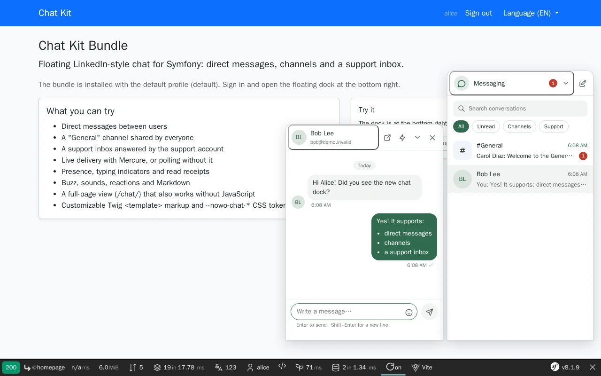

# Chat Kit Bundle

[](https://github.com/nowo-tech/ChatKitBundle/actions/workflows/ci.yml) [](https://packagist.org/packages/nowo-tech/chat-kit-bundle) [](https://packagist.org/packages/nowo-tech/chat-kit-bundle) [](LICENSE) [](https://php.net) [](https://symfony.com) [](https://github.com/nowo-tech/ChatKitBundle) [](#tests-and-coverage)

> ⭐ **Found this useful?** [Install from Packagist](https://packagist.org/packages/nowo-tech/chat-kit-bundle) · Give it a **star** on [GitHub](https://github.com/nowo-tech/ChatKitBundle) so more developers can find it.

**Chat Kit Bundle** — floating LinkedIn-style chat for Symfony: direct messages, channels and a support inbox with realtime (Mercure), presence, read receipts, typing, Web Push, customizable Twig templates and theme tokens.

> 📋 **Compatible with Symfony 7.4+ and 8.0–8.1+** — PHP 8.3+ (Symfony 8.x requires PHP 8.4+).


This bundle is **FrankenPHP worker mode friendly**. See [docs/FRANKENPHP-WORKER-AUDIT.md](docs/FRANKENPHP-WORKER-AUDIT.md).

## Features



- **Direct messages** between people your application allows to talk (you decide: same team, same project, anyone…)
- **Channels**: one group conversation per resource of your application (project, room, team) — `project:<uuid>`-style keys from your own provider
- **Support inbox**: every user has a thread with "Support"; your support agents answer, resolve and moderate
- **Realtime** through **Mercure** (FrankenPHP's built-in hub or standalone) with private per-user topics — polling fallback when it is off
- **Presence** (online dot, reciprocal opt-out), **typing** indicator and **read receipts** (✓✓ / "Seen by")
- **Edit and delete** your own messages within 15 minutes, **emoji reactions**, **buzz**, configurable **sounds**, **emoji picker**, light **Markdown** (sanitised on the server)
- **Support inbox page data**, "report a problem" links with context (`data-nowo-chat-open`), moderation events
- **Full-page chat** (`/chat/`) that also works without JavaScript; "open in a page" from every window
- **Link previews** of your own pages (checked per viewer) and an optional **email digest** of unread conversations
- **Web Push** only when the application is not open in any tab (your push stack, through one interface)
- LinkedIn-style **floating dock**: windows that survive navigation and stay in step across browser tabs; full-screen sheet on phones
- **Customisable markup**: every piece of the UI is a Twig `<template>` the TypeScript clones — override any block
- **Theme tokens** (`--nowo-chat-*`, light / dark defaults) and **Symfony UX Icons** (Tabler by default, any set)
- Rate limits, CSRF, IDOR-safe (foreign UUID → 404), no-store responses, retention purge, GDPR export / erasure hooks
- **FrankenPHP worker mode** friendly; 7 locales (en, es, fr, de, it, pt, nl)

## Installation

```bash
composer require nowo-tech/chat-kit-bundle
```

With **Symfony Flex**, the recipe registers the bundle and creates `config/packages/nowo_chat_kit.yaml` (set `user_class`) and `config/routes/nowo_chat_kit.yaml` (prefix `/chat`). Without Flex, see [docs/INSTALLATION.md](docs/INSTALLATION.md).

```php
// config/bundles.php
return [
    Nowo\ChatKitBundle\NowoChatKitBundle::class => ['all' => true],
];
```

## Quick start

1. Configure the profile (your user entity implements `Nowo\ChatKitBundle\Model\ChatUserInterface`):

```yaml
# config/packages/nowo_chat_kit.yaml
nowo_chat_kit:
    profiles:
        default:
            user_class: App\Entity\User
```

2. Import the routes, create the tables (`doctrine:migrations:diff`), and implement the two required contracts —
   `ChatDirectoryInterface` (users and contacts) and `ChatAccessPolicyInterface` (who can talk to whom):

```yaml
# config/routes/nowo_chat_kit.yaml
nowo_chat_kit:
    resource: '@NowoChatKitBundle/Resources/config/routes.php'
    prefix: /chat
```

3. Render the dock once in your signed-in layout:

```twig
{{ include('@NowoChatKitBundle/dock.html.twig') }}
```

Full guide: [docs/INSTALLATION.md](docs/INSTALLATION.md) · options: [docs/CONFIGURATION.md](docs/CONFIGURATION.md) · contracts, templates, theme, JS: [docs/USAGE.md](docs/USAGE.md).

## Requirements

- PHP `>=8.3 <8.6`
- Symfony 7.4, 8.0, and 8.1+
- Doctrine ORM, SecurityBundle, TwigBundle, Symfony UX Icons
- Optional: `symfony/mercure-bundle` (realtime), Symfony Messenger (async push), a Web Push library behind `ChatPushSenderInterface`

### Version information

| Version | PHP | Symfony | Status |
| --- | --- | --- | --- |
| 1.x | 8.3 – 8.5 | 7.4, 8.0, 8.1+ | Supported (bug and security fixes) |

## Demo

A Symfony 8.1 demo runs on FrankenPHP (worker mode by default) with MySQL:

```bash
make -C demo up
# Demo started at: http://localhost:8147
```

`make -C demo/symfony8 setup-db` seeds the accounts **alice**, **bob**, **carol** and **support** (password
`password`); sign in with two of them in two browsers. See [docs/DEMO-FRANKENPHP.md](docs/DEMO-FRANKENPHP.md).

## Documentation

- [Installation](docs/INSTALLATION.md)
- [Configuration](docs/CONFIGURATION.md)
- [Usage](docs/USAGE.md)
- [Contributing](docs/CONTRIBUTING.md)
- [Code of Conduct](CODE_OF_CONDUCT.md)
- [Changelog](docs/CHANGELOG.md)
- [Upgrading](docs/UPGRADING.md)
- [Release](docs/RELEASE.md)
- [Security](docs/SECURITY.md)
- [Engram](docs/ENGRAM.md)
- [Spec-driven development](docs/SPEC-DRIVEN-DEVELOPMENT.md)
- [GitHub Spec Kit](docs/SPEC-KIT.md)

### Additional documentation

- [Architecture](docs/ARCHITECTURE.md)
- [PSR evaluation](docs/PSR.md)
- [Coverage policy](docs/COVERAGE.md)
- [Demo FrankenPHP](docs/DEMO-FRANKENPHP.md)
- [FrankenPHP worker audit](docs/FRANKENPHP-WORKER-AUDIT.md)
- [GitHub CI](docs/GITHUB_CI.md)
- [GitHub About](docs/GITHUB.md)

## Tests and coverage

PHP line coverage target: **100%** of includable `src/` (gate **≥ 99%**). TypeScript line coverage target: **100%** (gate **≥ 90%**).

```bash
make test
make test-coverage
make test-ts
make qa
```

| Language | Latest reported |
| --- | --- |
| PHP | 100% lines (`make test-coverage`) |
| TypeScript | 100% lines (`pnpm run test:coverage`) |

## License

MIT © 2026 Héctor Franco Aceituno / Nowo.tech
